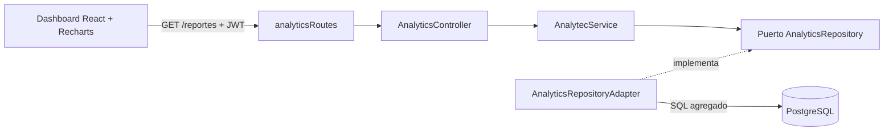

# Dashboard de métricas y reportes (Actividad 2.6)

## Alcance

El dashboard de administración consulta el historial de pedidos, detalle de pedidos, productos y usuarios para mostrar ingresos del periodo, cantidad de pedidos válidos, ticket promedio por pedido, gasto promedio por cliente, tendencia de ingresos, distribución de estados y ranking de productos. La vista solo se muestra a una sesión con rol `administrador`; la API verifica el JWT y el rol en cada solicitud.

## Arquitectura hexagonal



`AnalytecService` valida fechas, granularidad y tamaño del ranking. `AnalyticsRepositoryAdapter` ejecuta las agregaciones con `SUM`, `COUNT`, `AVG`, `GROUP BY` y `date_trunc` en PostgreSQL; Node recibe los resultados ya resumidos. El reporte analítico vive en un puerto propio y no agrega lógica de lectura a las entidades operativas.

## Métricas y reglas

- **Ingresos:** suma del total de pedidos no cancelados dentro del rango inclusivo.
- **Ticket por pedido:** ingresos válidos divididos entre pedidos no cancelados.
- **Gasto promedio por cliente:** gasto promedio del periodo entre clientes con compras válidas en ese periodo.
- **Tendencia:** ingresos y cantidad de pedidos no cancelados, agrupados por día, semana o mes.
- **Estados:** conteo y porcentaje de todos los pedidos del rango. Incluye `pendiente`, `pagado`, `preparando`, `enviado`, `entregado` y `cancelado`.
- **Productos:** unidades y monto de las líneas de pedido no canceladas, ordenadas por unidades y luego por ingresos.

## API

La ruta y el contrato de respuesta están descritos en [endpoints.md](endpoints.md), sección “Reportes analíticos”. Requiere el mismo token de sesión de la tienda y rol `administrador`.

## Configuración y uso

1. Aplica el esquema actualizado en `src/infrastructure/database/schema.sql` a la base de datos. Los índices de fecha/estado ayudan a las consultas de reportes. El esquema mantiene `image_url` para coincidir con las consultas del catálogo.
2. Configura `VITE_API_URL` para que apunte a la URL accesible del backend (por ejemplo `http://<IP-PUBLICA-DEL-BACKEND>:3000`) antes de compilar el frontend. En el backend, `CORS_ORIGIN` debe contener el origen exacto donde se publica el frontend. En producción es preferible HTTPS.
3. Instala dependencias e inicia backend y frontend según [README.md](../README.md). La dependencia de gráficos es Recharts.
4. Inicia sesión con un usuario que tenga rol administrador. Los registros nuevos nacen como `cliente`; para una base local de demostración, un administrador puede asignar el rol a una cuenta de prueba existente con:

   ```sql
   UPDATE usuarios SET rol = 'administrador' WHERE lower(email) = lower('admin-de-prueba@example.com');
   ```

   Sustituye el correo por el de la cuenta de prueba. No promociones usuarios en una tienda pública sin autorización.

5. Abre **Dashboard** en la navegación de administración. Elige últimos 7 días, últimos 30 días, este mes o rango personalizado; cambia agrupación y Top 5/Top 10. “Actualizar datos” vuelve a consultar el reporte.

Si el periodo no tiene ventas, el dashboard muestra métricas en cero y estados sin conteo; el ranking y la gráfica indican que aún no hay ventas. Para mostrar datos, crea pedidos de prueba desde el flujo de la tienda y avanza sus estados desde la administración. `tarjeta_demo` es solo ilustrativa y no procesa pagos reales.

## Evidencia visual para la entrega

La evidencia debe capturarse desde el navegador con una sesión administradora y datos visibles. Para la actividad conviene guardar una captura del dashboard con ventas y otra tras cambiar a rango personalizado o agrupación semanal/mensual. No se incluye una captura ficticia: debe tomarse de la aplicación ejecutándose con datos de demostración.
